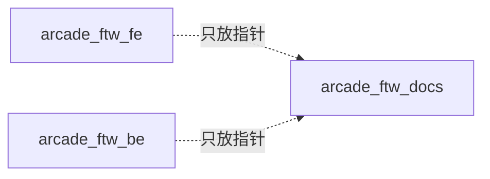

# arcade_ftw 文档库

Arcade FTW（第二个版本）的**跨项目唯一共享知识库**。

## 为什么单独一个 repo

前后端是两个**独立 repo**（`arcade_ftw_fe` / `arcade_ftw_be`），任何一方都无法看到对方目录里的文档。把共享文档塞进任一 repo 都会造成**所有权不对称**（只有一侧能改，另一侧 clone 出来看不到）——这正是上一代系统把 `SYSTEM_HANDBOOK.md` 放进前端 `doc/` 的遗留问题，不再重蹈。

## 作用域规则

| 文档 | 放哪 |
|---|---|
| README / 贡献指南 / 单服务内部说明 | ✅ 各自 repo 内 |
| WS 协议、题型契约、状态机语义 | ✅ **本 repo**（`protocol/`、`architecture/`）|
| 系统手册、AWS 清单、部署手册、runbook、ADR、红线 | ✅ **本 repo** |

## 目录

| 路径 | 内容 |
|---|---|
| [SYSTEM_HANDBOOK.md](./SYSTEM_HANDBOOK.md) | 跨 session 共享 memory（**开工前必读**）|
| [architecture/](./architecture) | 状态机语义、三个视图与房间、RDS 与迁移方案、架构决策记录（ADR）|
| [games/](./games) | 每个游戏节点的玩法与计分规则 |
| [protocol/](./protocol) | 前后端契约：WS 消息、题型定义 |
| [aws/](./aws) | 资源清单、部署要点 |
| [runbook/](./runbook) | 活动当天操作手册 |

> **强制规则（红线 / 行为约定）不在本 repo。** 它在 workspace 根的 `AI Arcade/.github/copilot-instructions.md`——刻意放在非 git 目录：这样它才落在 workspace 根被 Agent 自动加载（子目录里的 `copilot-instructions.md` 不会被加载），同时不污染任何 repo。
> ⚠️ 代价：它**不入版本库**，GitHub 云端 Copilot / CI / 其他 clone 都拿不到。

## 约定

1. **指针，不是副本**：代码 repo 只写一行「跨项目文档见 `../arcade_ftw_docs`」，绝不复制内容（复制必然分叉）。
2. **协议变更必须同 PR 更新 `protocol/`**，否则前后端 drift。
3. 状态变更（部署、建资源、改流程）后**回补本 repo**——它是唯一共享 memory。
